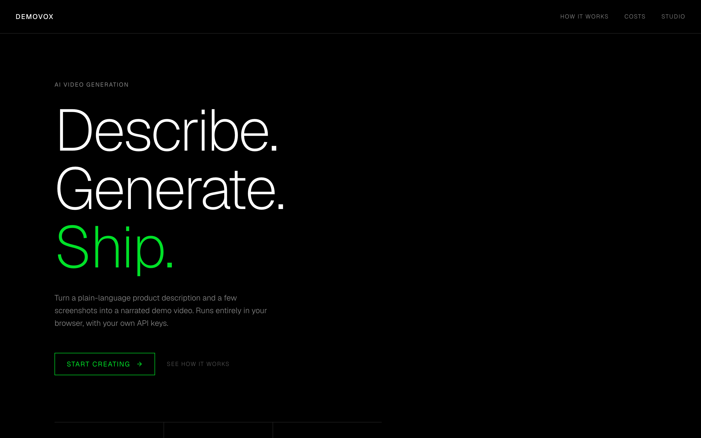
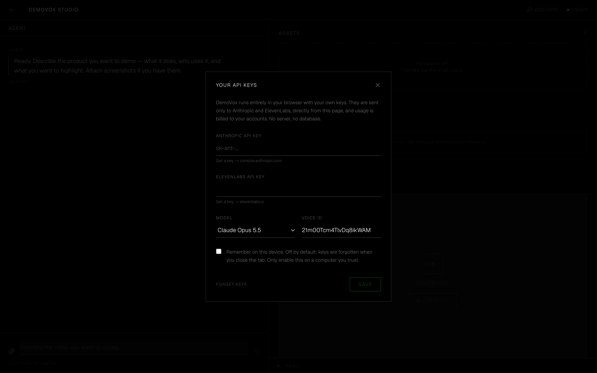
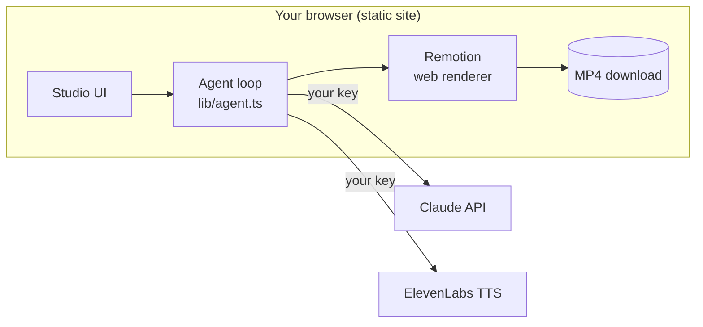

# DemoVox

**Describe your product. Get a narrated demo video.**

DemoVox is an AI agent that turns a plain-language product description and a few screenshots into a ready-to-share MP4: it writes the script, records the voiceover and renders the video — no editor, no timeline.

It runs **entirely in your browser with your own API keys**. There is no backend: nobody else can spend your credits, and your keys, screenshots and videos never reach a DemoVox server, because there isn't one.

> **Personal demo project.** DemoVox is a non-commercial proof of concept I built to explore AI agents and programmatic video. It is not a product and has no support or roadmap.

[](https://github.com/san97o/demovox/actions/workflows/ci.yml)




## How it works

1. **Bring your keys** — paste an Anthropic key and an ElevenLabs key. They stay in your browser tab.
2. **Describe** — tell the agent what your product does and attach up to 8 screenshots. Claude sees the screenshots.
3. **Script** — Claude writes a 15–35 second narration.
4. **Voice** — ElevenLabs turns the script into speech.
5. **Render** — a Remotion composition (title → screenshots → outro, timed to the voiceover) renders to MP4 in your tab with WebCodecs.

Every run shows an estimated cost (Claude tokens and ElevenLabs characters), and a history is kept in your browser.



## Architecture



**Interesting bits**

- **Agent loop without a framework or a server** — [`lib/agent.ts`](lib/agent.ts) runs the Claude Messages API in a plain loop in the browser: stream text, run tool calls (`generate_voiceover`, `render_video`), feed results back. Tool errors go back to the model instead of crashing the run.
- **Guardrails for the user's wallet** — each run is capped (model calls, voiceovers, renders, script length), and tool inputs are validated before anything is spent.
- **Video as React, rendered client-side** — [`remotion/compositions/ProductDemo.tsx`](remotion/compositions/ProductDemo.tsx) is a React component. [`@remotion/web-renderer`](https://www.remotion.dev/docs/web-renderer/) draws it frame by frame and encodes it with WebCodecs, so the video length simply follows the voiceover length.
- **Locked-down network** — production builds ship a Content Security Policy that only allows requests to Anthropic, ElevenLabs and Remotion's license counter. See [SECURITY.md](SECURITY.md).

## Tech stack

Next.js 16 (static export) · React 19 · TypeScript · Tailwind CSS 4 · Anthropic TypeScript SDK (Claude Opus / Sonnet / Haiku 5.5, selectable) · ElevenLabs API · Remotion web renderer

## Quick start

You need Node.js 20+, an [Anthropic API key](https://console.anthropic.com/settings/keys) and an [ElevenLabs API key](https://elevenlabs.io/app/settings/api-keys).

```bash
git clone https://github.com/san97o/demovox.git
cd demovox
npm install
npm run dev
```

Open http://localhost:3000, go to **Studio** and paste your keys. No `.env` file is needed.

Rendering needs a browser with WebCodecs — a recent Chrome or Edge works best. Keep the tab in the foreground while it renders.

Preview or tweak the video template without any API keys:

```bash
npm run remotion:studio
```

## Deploy

```bash
npm run build
```

This produces a static site in `out/`. Upload it to any static host (Cloudflare Pages, Netlify, Vercel, S3). The deployment holds no secrets, so it costs you nothing beyond hosting: every visitor uses their own keys.

`public/_headers` adds anti-clickjacking and other security headers on Netlify and Cloudflare Pages. On other hosts, set the same headers in their config.

## Privacy and security

- Keys are kept in `sessionStorage` and cleared when the tab closes, unless you tick **Remember on this device**.
- Keys are sent only to `api.anthropic.com` and `api.elevenlabs.io`, directly from your browser.
- Descriptions and screenshots go only to Anthropic. The script goes only to ElevenLabs. Audio and video never leave your machine.
- Remotion's renderer reports one usage event per render (your site's origin, no content) to `remotion.pro` for license accounting.
- Usage is billed to your own accounts. Use keys with spending limits, and revoke them when you are done.

Full details and how to report a vulnerability: [SECURITY.md](SECURITY.md).

## Project structure

```
app/
  page.tsx        Landing page
  studio/         Chat, assets, cost and preview
  costs/          Spend history (stored in your browser)
components/       Chat, studio panels, settings dialog, shadcn/ui primitives
lib/
  agent.ts        Claude tool-use loop and guardrails
  elevenlabs.ts   Text-to-speech call
  render.ts       Client-side MP4 rendering
  settings.ts     Keys and model choice (browser storage)
remotion/         Video composition
```

## Limitations

- One video template (1280×720, 30 fps).
- Cost figures are estimates from public list prices; your Anthropic and ElevenLabs dashboards are the source of truth.
- Client-side rendering supports a subset of CSS; see [Remotion's limitations](https://www.remotion.dev/docs/client-side-rendering/limitations) before changing the composition.

## License

DemoVox's code is [MIT](LICENSE).

Video rendering uses [Remotion](https://www.remotion.dev), which is not MIT and has [its own license](https://remotion.dev/license). This project uses it under Remotion's Free License, which covers individuals and non-commercial use like this demo.

If you fork DemoVox, the Remotion license applies to you separately: it stays free for individuals and small companies, but larger companies need a paid Remotion license. If you have one, set `NEXT_PUBLIC_REMOTION_LICENSE_KEY` (see `.env.example`).
